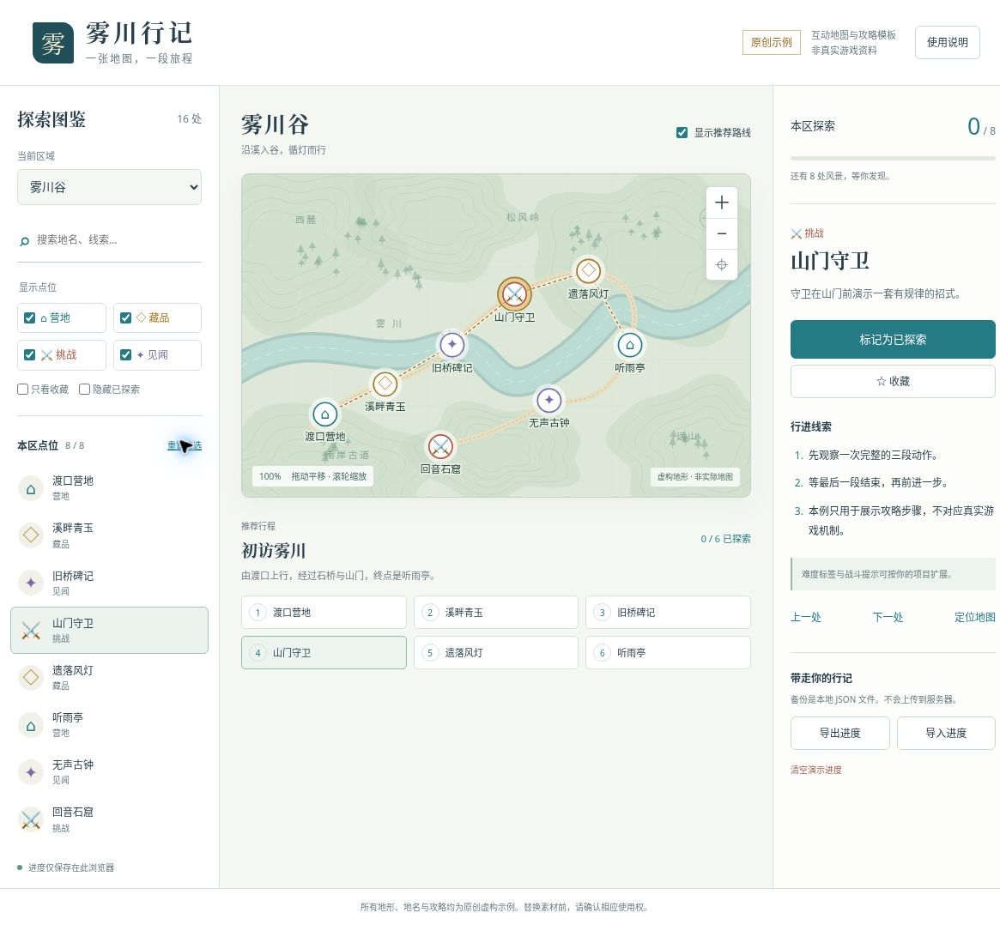
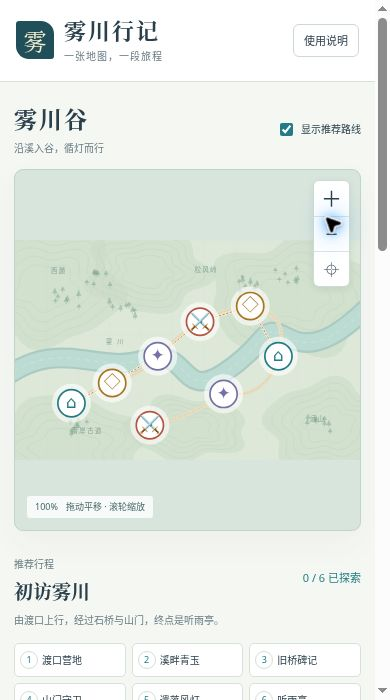

# 雾川行记：互动地图与攻略模板

一个可独立运行的中文互动地图示例。用两张原创虚构地图，演示地图、点位、攻略步骤和本地探索进度如何联动。

这是为已有游戏攻略项目整理的**重新编写的通用交互模板**，不是原站源码或游戏资料的打包导出。地图、地名、坐标、路线、文案和图形均为本次新作，不代表任何真实游戏内容。

## 先体验

- 最简单：解压后用现代浏览器打开 `preview.html`。它把页面、脚本、样式与 SVG 地图放在一个文件里，不需要安装依赖。
- 推荐：通过下面的本地 HTTP 服务启动，获得更稳定的本地进度保存行为。
- Space 中的附件用于保存和下载。附件预览器不等同于网站运行环境，请下载后在浏览器打开。

### Windows

安装了 Python 3 时，双击 `start.bat`，在浏览器打开：

`http://127.0.0.1:4173/`

### macOS / Linux

在此文件夹打开终端，运行：

```sh
sh start.sh
```

也可在安装了 Node.js 与 Python 3 的电脑运行 `npm start`。不需要 `npm install`。

停止服务：在终端按 Ctrl+C。默认只绑定本机 `127.0.0.1`，不会把电脑开放给局域网。

若 4173 端口被占用，可自行换为：

```sh
python3 -m http.server 4174 --bind 127.0.0.1 --directory dist
```

### 关于直接打开单文件

单文件不依赖服务器，但各浏览器对 `file://` 的本地存储规则可能不同。页面会提示保存失败；重要记录请导出 JSON。验收环境只允许 HTTP/HTTPS，单文件已通过 HTTP 运行与内容校验，未在真实 `file://` 或手机文件预览器中逐一验证。

## 包含的功能

- 雾川谷、星潮湾两张原创 SVG 地图，共 16 个点位、4 类标记、2 条推荐路线。
- 区域切换、当前区域关键词搜索、分类筛选、只看收藏、隐藏已探索。
- 地图拖动、滚轮和按钮缩放、复位；键盘方向键移动，+ / − 缩放，0 复位。
- 点位与目录、详情、推荐路线同步选择，上一处 / 下一处、定位地图。
- URL 片段记录所选区域与点位，支持浏览器后退 / 前进。
- 探索状态与收藏在当前浏览器保存；地图、目录、路线共用同一份记录。
- JSON 进度导入 / 导出、格式校验、导入和清空前确认。
- 存储损坏时显示未知状态并阻止静默覆盖；保存失败时显示提示。支持同源多窗口重新读取进度。
- 窄屏布局与手机详情入口、键盘焦点、可读标签和状态提示。

没有账号、数据库、统计脚本、远程字体、CDN、在线 AI 服务、API 密钥或第三方运行依赖。

## 截图

截图来自本模板的测试页面，不含原游戏资料或私人浏览器记录。截图中的勾选是为验收生成的演示状态，未作为初始进度写入交付文件。






## 目录

```text
dist/                  可由任意静态 HTTP 服务托管的页面
  index.html           页面结构和安全策略
  styles.css           响应式布局、地图标记样式
  data.js              原创区域、点位、分类、路线数据
  core.js              纯逻辑：筛选、进度校验、片段解析
  app.js               地图相机、界面联动、事件与本地存储
  assets/              两张原创 SVG 底图
preview.html           可下载的单文件体验版
tools/                 单文件生成工具
tests/                 无依赖 Node.js 测试
docs/                  截图、验收、素材与安全说明
start.sh / start.bat   本机启动脚本
LICENSE-STATUS.md      尚未选择对外开源许可证
```

## 换成你自己的项目

1. 先确认底图、点位资料、配图、文字和代码的使用权。不要直接把游戏截图、社区地图或他人攻略搬进模板。
2. 修改 `dist/data.js` 中的 `regions`、`points`、`routes` 和 `categories`。
3. 坐标采用 `1100 × 700` 的示意平面。`x` 从左向右，`y` 从上向下；这不是经纬度。
4. 每个点位的 `id` 保持唯一且稳定。点位 `region`、`category` 和路线 `points` 必须引用存在的 ID。
5. 每个区域当前配置一条推荐路线。多路线、地图瓦片和大型数据集需要进一步扩展。
6. 图片放入 `dist/assets/`，不要填写临时签名地址、私人文件链接或跨站账号地址。
7. 修改 `index.html` 的站名、说明与 `styles.css` 的颜色。输入数据始终以纯文本渲染，不要改为直接插入不可信 HTML。
8. 更换数据集时，同时修改 `app.js` 的 `STORAGE_KEY`，避免与旧演示进度混用。若要保留真实记录，需要另写并测试迁移方案。

这里的自动测试有意锁定当前 2 区 / 16 点位与静态文件白名单。合法扩展数据后，应更新对应测试，不要为了通过检查而删掉安全断言。

## 测试与重建单文件

需要 Node.js 20 或以上，未引入 npm 依赖：

```sh
npm test
node tools/build-standalone.cjs
```

修改 `dist/` 后需要重新生成 `preview.html`。单文件使用脚本与样式内容哈希作为 CSP 授权，不使用 `unsafe-inline`。单独改动生成后的 HTML 会使哈希不匹配，应修改源文件并重新生成。

具体已验收与未验收项目见 [验收记录](docs/VERIFICATION.md)。

## AI 辅助方式

代码、SVG 地形、虚构数据、说明和测试使用 AI 辅助编写，再通过自动测试、静态检查和浏览器交互检查校正。运行模板本身不会调用 AI，也不会上传进度。

可继续使用这样的提示词扩展：

> 为这个纯静态互动地图增加一个原创虚构区域。保持点位 ID 稳定、无远程请求，不引入真实游戏素材。更新数据引用、输入校验和测试，保留本地进度的失败提示。不要发布或上传仓库。

AI 生成与自动检查不能代替素材权利审核、真实游戏资料核验或全面安全审计。

## 已知限制

- 全部内容为虚构示例，不可作为真实游戏攻略使用。
- 不与游戏客户端、Steam、账号或跨设备服务同步。
- 同源多窗口使用最后一次保存的完整进度，不提供冲突合并；同时编辑可能互相覆盖。
- 更换域名、端口、浏览器或清除浏览数据后，不会自动迁移记录。请导出再导入。
- 手机支持单指拖动和按钮缩放，未实现双指缩放；未做真实 iOS / Android 设备兼容性验收。
- 路线是示意连接线，不是自动寻路。没有瓦片加载、聚合标记、重叠点位选择器或后台编辑器。
- 搜索是当前区域内的连续关键词匹配，不是全文检索或多词分词搜索。
- 面向少量示例点位设计；大量点位需性能优化与无障碍复测。
- 本仓库提供模板源码、文档和截图；没有部署在线体验站点。

## 分享与许可

本项目已作为公开 GitHub 仓库分享，当前未选择开源许可证。公开可见不等于授予开源许可；项目没有附加第三方再分发或商用许可。请查看 [许可状态](LICENSE-STATUS.md) 与 [素材和安全说明](docs/PROVENANCE-AND-SECURITY.md)。

此前交付的源码 ZIP 包附带 `clean-history.bundle`，只包含本模板从零建立的单个初始提交，无原项目历史或远程地址。需要 Git 工作区时可在包外运行：

```sh
git clone clean-history.bundle mistvale-map-template
```

不需要 Git 也能运行本模板。此前交付的 ZIP 包内含 `SHA256SUMS.txt`；GitHub 下载包以仓库提交记录为准。
